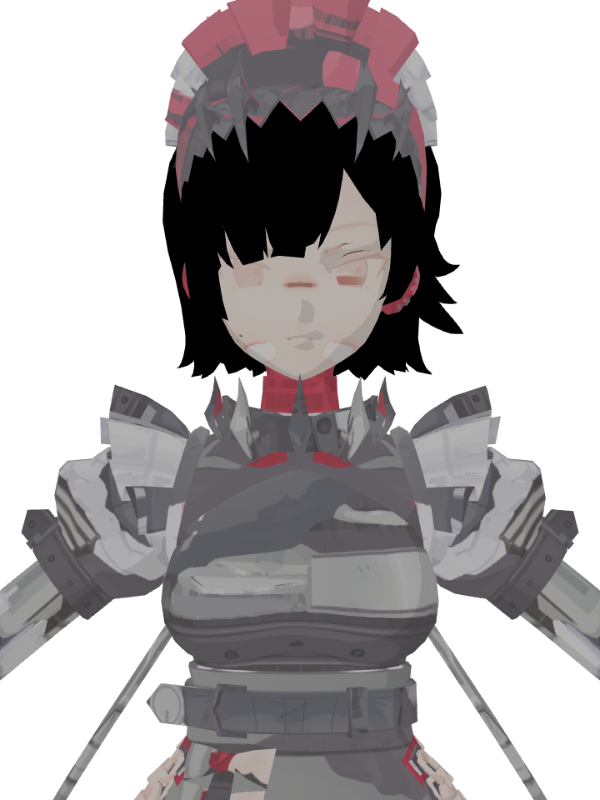
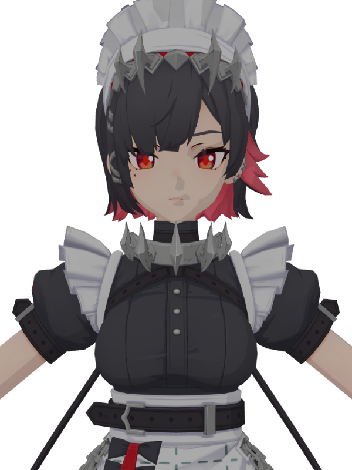
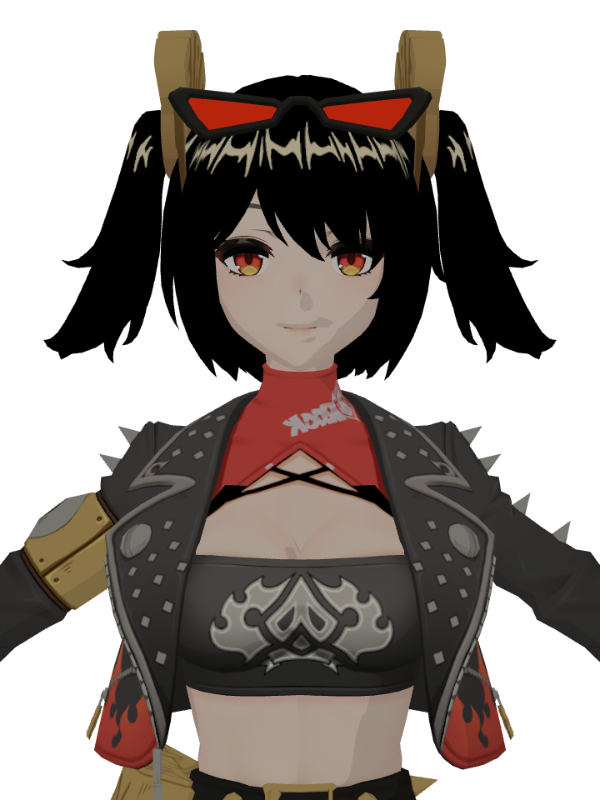
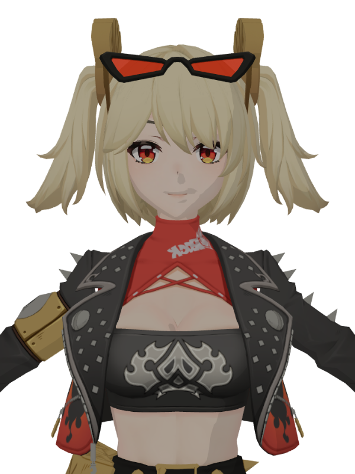
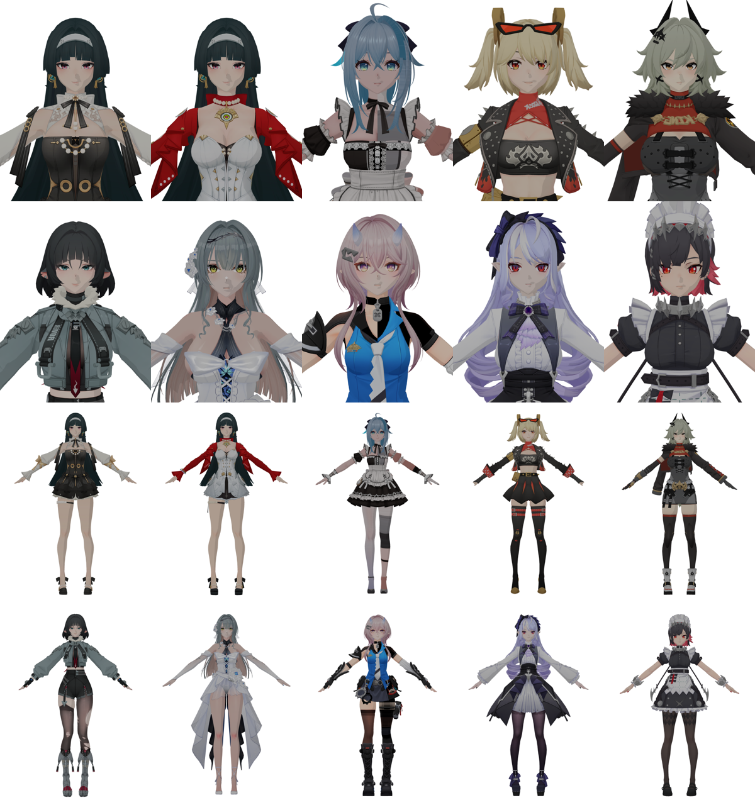
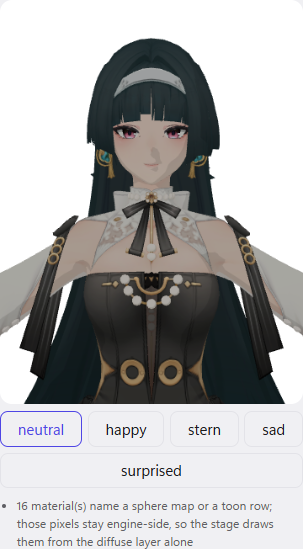
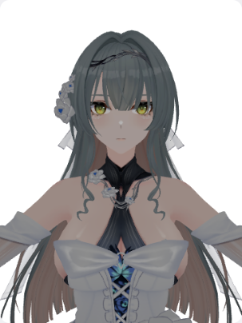
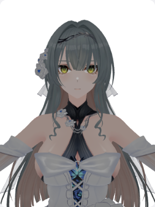
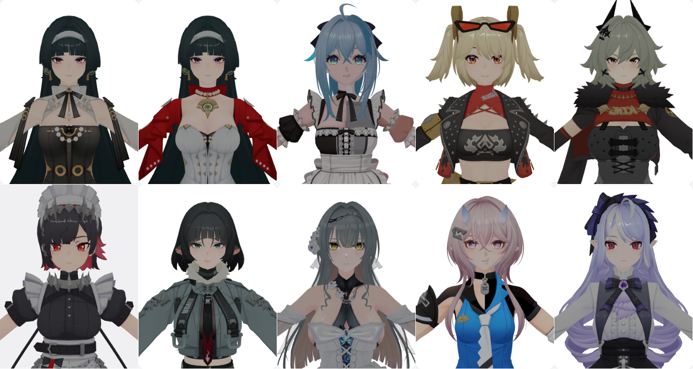

# Avatar Stage — texture transfer re-pass

The first live pass ([`avatar-stage-pass.md`](avatar-stage-pass.md)) got all ten donor archives to
load. This one answers the next question: whether what the browser drew was the model in the archive.
It was not. Four bugs in the texture half of the transfer made every body wrong in the same way.

All the texture fixes live in `kira-chat/src/avatar/load.ts`, as do the shading ones below. The
texture screenshots were taken from the stage camera at 720 × 960 (2× the 360 × 480 buffer) against the
engine's own file routes; the shading images are the app's own card, where the stage draws at 303 × 404.

## What was wrong

### 1. The UV origin was not converted

PMX names a pixel with `v = 0` at the top of the image, the way DirectX does. Three uploads images
flipped, so its `v = 0` is the bottom row. The file's coordinates were passed through untouched, so
every body sampled its texture upside down: the painted eye sockets landed near the mouth, the eye and
iris meshes sat behind the skin, and clothing read as the wrong half of its atlas.

`flipUV()` inverts `v` once, on the geometry the loader already owns.

| before | after |
| --- | --- |
|  |  |

The same frame also shows the second bug: the before image is a washed-out photocopy.

### 2. A decoded `.tga` had no colour space

`TGALoader.createDataTexture()` returns a `DataTexture` whose `colorSpace` is unset, which three
samples as linear. Every `.tga` diffuse map in the corpus — Ellen's face, most of Astra's atlas — read
as pale skin and grey cloth. `decodeTga()` now labels the texture `SRGBColorSpace`, matching what the
host does for PNG/BMP.

### 3. The double-sided bit was the vertex-colour bit

`DOUBLE_SIDED_BIT` was `0x20`. In PMX's material flag byte, bit 0 (`0x01`) is "draw both sides";
`0x20` is vertex colour. Every material with a texture and a vertex-colour flag was drawn single-sided,
and every genuinely two-sided skirt, hair shell and sleeve lost its far face. The constant is now
`0x01`; the fixture's two materials (flags 0 and 1) pin the direction in `load.test.ts`.

### 4. The diffuse map's own alpha was ignored

MMD blends the texture alpha. The corpus depends on it in ways that are invisible until it is missing:

- Burnice's hair is blonde under a mostly transparent shading layer. Opaque, the layer painted the
  whole head black.
- Ellen's red hair tips are the faded end of hair cards; opaque, they were a black wedge.
- Astra's headband is a partly transparent band under the front hair; opaque, it disappeared.

A material with a map is now blended even when its own alpha is 1, with `depthWrite` left on, which is
what MMD does: the material order in the file is back-to-front, and this mesh draws its groups in that
order.

| before | after |
| --- | --- |
|  |  |

## Verification

All ten donors, portrait (stage camera) above and full body below. No magenta placeholder is visible;
each body's painted face, irises, hair and clothing are its own.

The same loader in the app route, `#/avatar`, staging Astra (the headband and the blended hair are
the two newest changes):

Bodies were also read for animation: the blink is driven from `まばたき` in the KRM1 mesh, which is
where the stage looks it up. Astra and Burnice publish no morph *names* in their profile report — the
engine's walk resynchronises past their wider morph table — yet their meshes still carry 36 (Astra)
and 46 (Burnice) named vertex morphs, `まばたき` among them, so the blink and the visemes move. `docs/qa/avatar-stage-pass.md` records the transfer itself; this page only records
what the pixels now show.

## Re-pass — the two layers three has no slot for

With the maps reading correctly, the next difference was in the shading itself. A PMX material names a
`toon` ramp and may name a `sphere` map; `MeshToonMaterial` has one of those (`gradientMap`) and
three draws neither the way MMD does. Both are now wired through one patched program per material.

**Toon ramps.** Every donor's material table indexes a ramp in the same texture table as its diffuse
maps — `skin.bmp`, `hair.bmp`, `toon_defo.bmp`, `toon2.png` — and those ramps carry the model's
shadow tint, not just a grey step. Two mismatches had to be fixed on the way in: a PMX ramp runs down
the image (`v`) while three samples a gradient map along `u`, and three reads only the red channel.
The patch swaps the sample to `vec2( 0.5, dotNL * 0.5 + 0.5 )` and returns `.rgb`, so the tinted bands
land where the file drew them. Materials whose toon is one of MMD's ten built-in rows are left to the
light (there is no file to read), and the stage says so.

**Sphere maps.** Twenty of `model-d055`'s materials and Astra's `髮+` name a sphere map — a second
texture looked up by the view-space normal, which MMD applies after the lights. Modes 1 (multiply),
2 (add) and 3 (alpha sub-texture) are injected where the lit colour is summed; mode 2 is what both
donors use, and the soft ring in `mc3.png` is the rim light the character was authored with.

| sphere pass off | sphere pass on |
| --- | --- |
|  |  |

The diff is the sheen along the shoulders, chest and hair edges; nothing else moves.

All ten with both layers, portrait at the stage camera:

A missing file now also says what it costs. JaneDoe's archive lost `hair.bmp`, but the material that
names it uses it as a **toon ramp**, not a diffuse map — the old finding told the reader a face was
magenta when nothing on the stage was. `textureUse()` reads the material table and the finding now
says "shaded by the light alone"; magenta is claimed only when a missing file is a diffuse map.

## Still not reproduced

These are reported in the stage's findings list and are not texture-transfer bugs:

- **MMD's built-in toon rows.** A material can name one of ten ramps that live inside MMD itself rather
  than in the archive (one teeth material in most donors). There is no file to read, so those pixels
  keep three's own band and the finding says so.
- **Absent textures.** JaneDoe's `hair.bmp` is not in its archive, and its three materials keep the
  light-only shading above. A missing *diffuse* map still draws magenta by design, so a missing part is
  visible rather than silently black.
- **Bind pose.** The stage does not pose arms down; the arms in the full-body renders are the file's
  T-pose. The stage camera frames the head and shoulders, where the pose does not show.

## Checks

- `npx tsc --noEmit` — clean
- `npx vitest run` — 51 files, 534 tests pass (20 in `avatar/load.test.ts`, now including the UV flip,
  the TGA colour space, the alpha blend, both sides of the flag byte, the toon axis and tint, the sphere
  injection and the role-aware missing-file wording)
- engine `pytest` — 862 passed, 8 skipped
- `npm run build` — clean
